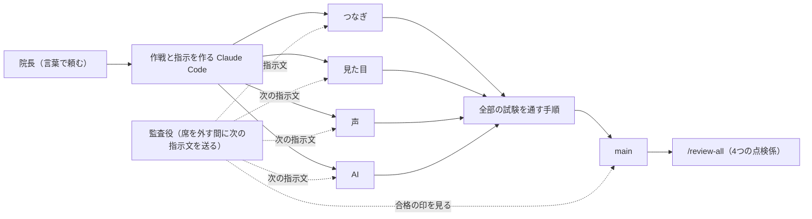

# Chairside View｜チェアサイドビュー

<p align="center">
<a href="https://youtu.be/-rkO4wW4goY"></a>
<a href="https://youtu.be/BmFt_KhNKSM"></a>
</p>
<p align="center"><a href="https://youtu.be/-rkO4wW4goY">▶ 紹介動画（約6分）</a>　｜　<a href="https://youtu.be/BmFt_KhNKSM">▶ 大会に提出したデモ動画（3分）</a></p>

治療中、画面に触れずに、必要な情報へ。

歯科医師が現場の「困った」から考え、Claude Code と5日間で形にした、声と3つのボタンで動く診療支援の試作品です。

Built with Claude: Japan 2026 提出作品

## 自由に使ってください

このリポジトリは MIT License で公開しています。これを土台に、自由に使ってください。

- 歯科医院でも、システムを作る会社でも、有料・無料を問わず、使う・直す・配る・売る・自社の製品に組み込むことができます。
- 自分の医院のパソコンで動かしても、ローカルの AI に読み込ませて使っても構いません。
- 条件は1つだけです。LICENSE にある著作者の表示とライセンスの文を残してください。
- 著作権は大川内秀幸が持ったままです。改造版を作った方も、この元のコードを自分だけのものにすることはできません。
- 改造版には、できれば「チェアサイドビュー」とは別の名前を付けてください（お願いです）。
- 医療機器ではありません。診療の判断には使わないでください。動作の保証はありません。

---

## 患者様は、口を開けたまま待っている

歯を削っている途中で、ふと気になる。「この患者様、薬のアレルギーはあっただろうか」。

記録はある。でも手袋をした手では画面に触れない。手袋を外すか、スタッフに操作を頼むか。写真を拡大したいときも、前回の処置を確かめたいときも同じです。必要な情報が、いま目の前の患者様と、画面の向こうとに分かれてしまう。

診療の手を止めずに、確認したい情報をその場で見られないか。

その問いから作ったのが Chairside View です。患者様を選ぶのは治療前。手袋をしたあとは、手元の3つのボタンと声で画面を動かします。たとえば「アレルギーは？」「前回は何をした？」「写真の3番を拡大して」。必要な記録が、その場で大きく表示されます。

> **AIはあくまでも確認と記録を手伝うだけで、アドバイスはしません。**

すでに記録されている情報にたどり着くこと、診療中に話した内容を記録の下書きにすること。その2つを、医療者の手元で助けます。

## 動画で見せている機能

| 場面 | Chairside View でできること |
|---|---|
| **1. 見たい情報を、声で呼び出す** | 重要事項・全身既往・治療計画・過去の診療メモ・写真・歯の状態・歯周検査を全画面に。写真は番号で選んで拡大したり、並べて比べたりできます。 |
| **2. 記録に質問する** | 「アレルギーは？」「前回は何をした？」と尋ねると、該当する**記録を、書いてあるとおりに**大きく出します。記録に無い答えを AI が作る機能はありません。 |
| **3. 診療中の会話を、下書きへ** | 録音すると、文字起こしと歯科の言葉への清書は自動で進みます。「今日の分をまとめて要約」を押すと、5項目の下書きを作ります。**人が見て確定するまでは、記録に入りません。** |
| **4. 役割に応じて、見るものを変える** | 歯科医師は診療の情報を中心に、歯科衛生士は歯周検査・メンテナンス間隔・ケア用品の購入履歴を出します。受付には別の入口と画面を用意しました。 |
| **5. スマホの写真を受け取る** | 画面に出した QR コードから、スマホの写真を見本の患者様の画面へ取り込めます。QR の有効期限は10分です。 |

録音・声の指示・画面を隠す操作は、役割が違っても同じ3つのボタンです。誤って触れても動きにくいよう、始めるときは2回押しにしています（録音と声の受付を止めるときは1回押し）。画面を隠している間は、患者様の情報を出しません。予約一覧では患者様のお名前を伏せ字で出し、「表示」を押した方だけ、その画面の中で出します。

目指しているのは、画面の操作の時間を減らし、患者様に向き合う時間を増やすことです。

この効果を、臨床の現場で数字で確かめたわけではありません。今は、架空のデータで動く試作品です。それでも、現場で何度も起きる小さな中断を、具体的な操作に落とし込めました。

## 現場で試したからこそ、気づけたこと

最初の版は、自動の試験が全部通っていました。でも、実際に診療室のマイクに向かって話すと、**覆髄（ふくずい）が抜髄（ばつずい）** になって画面に出ました。聞き取りが「副髄」と誤り、それを歯科の言葉へ直す段が、別の処置の名前に直していたのです。

字は一文字違いでも、歯の神経を残す処置と取る処置。医療者にとっては、見過ごせない違いです。音楽の流れるユニットでは「5番」「8番」も聞き違えました。

そこで、声で呼ぶ番号から5と8を外し、直す段を、話の流れから読み直す清書に作り替え、元の聞き取りの文も残しました。清書では直した言葉に下線を引き、歯の番号・日付・薬の量が変わったときや、文が長くなりすぎたときは、聞き取りのままの文を出します。AI が直した結果をそのまま使わず、人が見比べられる形にするためです。

プログラムを書けない私が、現場で失敗を見つけ、言葉で直しを頼み、また現場で試す。Claude Code との開発は、その繰り返しでした。

## AI に任せること、任せないこと

| 任せること | 任せないこと |
|---|---|
| 記録の候補を選ぶ（Claude は**番号**を返し、本文は元のデータから出す） | 記録に無い答えを作ること・アドバイス |
| 音声認識で得た文の、歯科の言葉を清書する | 聞いていない事実を足すこと・清書の結果をそのまま使うこと |
| 診療中に話したことを、5項目の下書きに分ける | 人が確定する前に、記録へ入れること |

決まった画面の操作や、「アレルギーは？」「前回は？」などよく聞く質問は、AI の返事を待たず、手元の表で処理します。それ以外の質問だけ Claude Haiku に記録の番号を選ばせ、清書と下書きには Claude Sonnet を使います（くわしくは下の「Claude の使い方」）。

Claude へ送る文は、アプリの中の送信口で、患者様・職員の名前やカルテ番号などを伏字にしてから渡し、元に戻す必要がある所はアプリの側で扱います。伏字にしたあとも名前などが残っていると分かったときは、送りません。すべての個人情報を必ず見つけられるとは限らず、実在の患者様のデータでは試していません。

見本の患者様・診療記録・写真は、すべて架空か見本用です。実在する患者様の情報は入れていません。本物の電子カルテとのつなぎ込み、使う人ごとの権限の管理、画像の診断は作っていません。

## できたと言える条件

「できた」の線は、自分で確かめられることにしました。

- Claude の鍵も、音声認識のモデルも無い状態で README のとおり起動し、`&typed=1` の文字入力で、決まった言葉の操作が動くこと。新しく clone して手で確かめました（docs/点検結果.md）。この状態を一度に通す自動の試験は、まだありません。
- `python -m pytest -m "not gpu"` の962件が全部通ること。
- 見本の患者様で、予約一覧から記録の全画面まで、画面の試験（tests/test_e2e_flow.py と tests/test_fullscreen.py）が通ること。
- 下書きは、人が確定するまで診療メモにも治療計画にも入らず、画面に「まだ記録に入っていません」と出ること。

## 歯科医師が、Claude Code でどこまで作れるか

私は福岡県で歯科医院を開業している歯科医師です。ソフトウェアの開発者ではなく、自分ではプログラムを書けません。一方で、必要な画面の情報、診療中の手の動き、聞き違えると危ない言葉なら、具体的に説明できます。

2026年11月2日から6日までの5日間、「何を作るか」は現場を知る私が決め、「どう作るか」は Claude Code と進めました。進め方は下の「開発の進め方」に書いています。

仕様の下書きや、進行の管理の仕組みの一部は、開始前に用意しました。この作品のアプリ本体のコードと画面は、期間中に新しく作りました。自院には以前から、情報を見たり声で入力したりできる別の自作のシステムがありますが、そのコード・ファイル・画面は使っていません。

- **962件**: GPU を使わない自動の試験の数。提出の前に全部通しました。
- **30問中30問**: 架空のデータで自由な質問を作り、モデルを比べたとき、採用した Haiku が正しく選んだ数（「該当なし」の5問を含む。1回ずつの試験で、一般の正答率を示すものではありません）。
- **4,308回中4,270回**: 記録した Claude Code の道具の使用のうち、私に聞かずに進んだ回数（安全の自動判定や、前もって許可した設定によるものを含む）。

何を作るかと、どの直しを採るかは私が決め、書く・試す・やり直すは Claude Code が受け持ちました。数え方と内訳は [docs/Claudeの使い方.md](docs/Claudeの使い方.md)、本物の Claude で比べた結果は [docs/モデルの選び方.md](docs/モデルの選び方.md) と [docs/実API結果.md](docs/実API結果.md) にあります。

## 審査の方へ: マイクも Claude の鍵も無しで、まず触れます

Windows で確かめた作品です。声の代わりに文字で操作する入力欄があり、Claude の鍵も音声認識のモデルも無い状態で、画面の表示や決まった操作を試せます。自由な質問・清書・下書きなど、Claude を呼ぶ機能には別に鍵が要ります。

### いちばん短い触り方

1. 下の「起動のしかた」で起動し、`http://127.0.0.1:8840/` を開きます。
2. 右の「臨床モード」を押し、予約一覧のカルテ番号 0123 の行を押します。
3. 開いた歯科医師の画面のアドレスの最後に `&typed=1` を足して開き直すと、右下に文字の入力欄が出ます。
4. 「重要事項を全画面にして」→「戻して」→「アレルギーは？」と打ちます。よく聞く質問なので、鍵が無くても動きます。
5. 「写真の3番を拡大して」や、画面の「役割を変える」も試せます。録音の下書きだけを試すときは、`/recordings` の「文字を貼り付けて下書きにする」から進めます（下書きを作るには鍵が要ります）。

### 起動のしかたと、要るもの

Windows で作って確かめています。必要なものは次のとおりです。

- Python 3.10 以上（作者は 3.12）
- ffmpeg（録音を音声に戻すのに使う。PATH に通しておく）
- 画面の試験を動かすなら Microsoft Edge（Playwright から呼ぶ）
- 文字起こしは GPU（NVIDIA）があると速い。無いと CPU で動くが、遅くなる。

```
python -m venv .venv
.venv\Scripts\activate
python -m pip install -r requirements.txt
python scripts/seed.py
start.bat
```

- 部品の一覧は requirements.txt。架空のデータは `python scripts/seed.py` で作る（data/runtime に作られる。コミットしない。動いているサーバーのデータも初期の状態に戻るので、動かすのは起動の前）。
- 起動は `start.bat`。既定のポートは 8840 で、環境変数 CV_PORT で変える。スマホの写真の受け渡し用に、別のポート（既定 8841、環境変数 CV_MOBILE_PORT）の小さなサーバーが、アプリの起動のときに自動で立ち上がる。`start.bat` は院内の他の端末からも開けるように、ネットワーク全体で待ち受ける。手元のパソコンから開くアドレスは `http://127.0.0.1:8840` 。
- 最初に開くのは入口の画面（`http://127.0.0.1:8840/`）。右の「臨床モード」を押すと今日の予約一覧（/clinic）。0123 の行を押すと歯科医師の画面が開く。左の「受付モード」は受付用の患者様一覧（/reception）。
- **マイクが無くても試せます。** 歯科医師の画面（`/unit?appt=…`）のアドレスの最後に `&typed=1` を足すと、右下に文字の入力欄が出る。声の代わりに「重要事項を全画面にして」「アレルギーは？」と打てば、同じ動きをする。
- 録音は、マイクがなくても `/recordings` を開き、「文字を貼り付けて下書きにする」の欄に話した内容の文字を貼ると、下書きまで試せる。
- ブラウザのマイクは、`http://127.0.0.1` か `http://localhost`、または https のアドレスでしか使えない（ブラウザの決まり）。
- ボタンは Ctrl+Shift+F6（ボタン1・録音）、F7（ボタン2・声の指示）、F8（ボタン3・画面を隠す）。始めるときは2回押し（1回目は帯が出るだけ。5秒以内にもう一度）。録音中と声の受付中は、1回押すと止まる。
- **Claude の鍵が無いと使えない機能**: 質問のうち「よく聞く質問」以外、聞き違いの清書、話した内容の下書き。鍵は環境変数 `CHAIRSIDE_CLAUDE_KEY` で渡す。無いときは、その機能だけ画面に「使えません」と出て、ほかは動く。鍵はリポジトリに入れない。
- **GPU や文字起こしのモデルが無いと使えない機能**: 声と録音の文字起こし。初めて使うとき、モデル（Whisper large-v3）を自動で取得する（数 GB。置き場は環境変数 CV_CACHE、無ければ作品のフォルダの隣の _cache）。取得しない状態でも、文字の入力（上の `&typed=1`）で、決まった言葉の操作は全部動く。
- 試験は `python -m pytest -m "not gpu"`（偽物の Claude の口と偽物のマイクで動く。画面の試験は Edge が要る）。GPU を使う試験は `-m gpu`。

## Claude の使い方

### 作品の中で Claude が担当すること

作品が動いているとき、Claude を呼ぶのは3か所だけです（表の下の3行）。上の2行は、Claude を使わずに表で動かします。

| 場面 | どうしているか |
|---|---|
| 決まった言葉（全画面、戻して、など） | 手元の言葉の表で照合する。Claude は使わない |
| よく聞く質問（前回・アレルギー・薬・次回） | 言葉の表（config/quick_answers.json）で記録から直接出す。Claude は使わない |
| それ以外の質問 | Claude Haiku が、記録の番号を選ぶ。本文はデータベースの文字をそのまま出す |
| 聞き違いの清書 | Claude Sonnet が、聞き取りの文を歯科の言葉に直した全文と、直した所の一覧を返す。話していないことは足さない |
| 話した内容の下書き | Claude Sonnet が5項目に分ける。話していないことは足さない（抜き出しの照合） |

「よく聞く質問は Claude を通さない」のは、診療中は待たされたくないからです。最初の版は質問を全部 Claude（Sonnet）に聞いていて、1問に約2.1秒かかりました（docs/実API結果.md の G16 の試験）。待ち時間はほとんど Claude の返事待ちだったので、よく聞く4つは表から直接出し、そのほかの質問は下の実測で選んだ Haiku にしました。

モデルは実測で選びました（docs/モデルの選び方.md）。架空のデータで声の質問30問を作り、Haiku・Sonnet・Opus に1回ずつ答えさせた結果は次のとおりです。

| モデル | 正解（30問） | 時間の中央値 |
|---|---|---|
| claude-haiku-5-5（採用） | 30 / 30 | 1.05秒 |
| claude-sonnet-5-5 | 29 / 30 | 1.48秒 |
| claude-opus-5-5 | 29 / 30 | 1.86秒 |

清書は、Sonnet と Opus を同じ文で3回ずつ試し、どちらも 45 / 45 で直し残し・余計な直しは0でした。正しさが同じなので、速い Sonnet（平均3.8秒、Opus は4.0秒）にしました（docs/清書のモデル比べ.md）。モデル名はプログラムに書かず、config/model.json から読みます。本物の Claude を呼んで確かめた結果は docs/実API結果.md に残しています。

### 開発の進め方

言葉の指示だけで作りました。

Claude Code を開発の中心に置き、4つの作業場を同時に動かしました。「つなぎ」（データと画面の入口）、「見た目」、「声」、「AI」です。同じ時間に、別々の担当の Claude Code が、別々のファイルを直します。ぶつからないよう、担当ごとに直すファイルを決め、出来上がったものは、全部の試験を通してから main へ入れる決まりの手順（大会用の道具）を必ず通しました。11/2 から 11/6 までの5日間（暦の日数。Claude の使い方の数字は、11/2 12:30 から 11/6 23:34 までの約4日半を数えたもの）で、制作記録は100行を超え、全件の試験は962件です。

窓ごとのモデルは、記録を数えた範囲（上と同じ約4日半の、道具を使った回数）で次のとおりです。つなぎは Sonnet 5.5 が990回、声は Sonnet 5.5 が973回、AI は Sonnet 5.5 が1,194回。見た目は Opus 5.5 が447回と Sonnet 5.5 が145回。次の指示文を送る監査役の窓は Haiku 5.5 が229回です。このほか、つなぎと AI の窓が呼んだサブエージェント（Sonnet 5.5 と Haiku 5.5）が300回、最初の準備の窓が30回で、合わせて4,308回です。コードを書く窓には Sonnet、見た目の仕上げには Opus、指示文を送る役には Haiku、と目的で分けました。

作戦を立てて指示を作る Claude Code と、作品を作る Claude Code は、別にしました。作業場の会話を軽く保つためと、医院の本番の情報や既存のコードが作業場へ入らないようにするためです。

作戦を立てる Claude Code が指示文を書き、作品を作る Claude Code には「○○.txt を読んで進めて」と貼るだけにしました。上の 4,308回中4,270回は、この形で数えたものです。11/2〜11/6 の約4日半で、作る Claude に聞かれて私が答えたのは22回だけでした。

作る窓は4つのまま増やさず、節目で /clear して軽くしました（指示と決めたことは作戦を立てる側が持ちます）。数え方と細かい数字は [docs/Claudeの使い方.md](docs/Claudeの使い方.md) にあります。

1つのアカウントでも同じ形はとれるはずですが、1つでは試していません。



### 期間中に作った開発の道具

- `.claude/agents` の読むだけの点検係4つ: medical-wording（診断や提案に読める言い方を探す）、public-safety（公開してよいかを調べる）、judge-view（初めて見る人の目で読む）、test-gap（試験の無い所を挙げる）。
- スキル `/review-all`: 4つの係を同時に立て、結果を docs/総点検.md の表にまとめる。
- コミット前のフック（.claude/hooks/commit_guard.py）: 鍵・音声・位置情報つきの写真・data/runtime をコミットの前に止める。
- サブエージェントで分けた場面: 11/3 に /review-all を作って試したとき、4つを同時に立てた（最初の型の指定では結果が残らず、同じ4つを立て直した）。11/6 の提出前の点検（G27）でも、4つを同時に立てた。公開の点検では、見本の名前や写真の出どころなど、院長が決めることの洗い出しが見つかった。くわしくは docs/総点検.md。

### 開始前から使っている仕組み

次のものは、期間の前から使っている仕組みで、評価の対象ではありません。

- 連続実行の `/longrun`（長い仕事を、終わりの条件を決めて続ける仕組み）
- 進行管理の Claude Code

### 開始前日に、この大会のために用意したもの

- 監査役の窓（Claude Haiku 5.5）: 私が席を外す間に、作業の窓の合格の印を確かめて、次の指示文を1つずつ送る Claude Code。コードは書きません。手順書と進み具合を見る道具は開始前日（11/1）に用意し、動かしたのは期間中です。

## 素材の出どころ

審査の対象は、Claude Code で作ったプログラムです。

- 写真はすべて見本の画像で、実在の患者様ではありません。見本の画像は、模型を撮影したり、生成 AI を使ったりして作りました。
- アプリそのものの素材（書体など）は、下の「使った部品とライセンス」に、ライセンスつきで書いています。
- 音声の録音・送信の記録・データベースは、リポジトリに入れません（data/runtime は .gitignore）。

## 使った部品とライセンス

作者の環境で動いている版です（requirements.txt、くわしくは docs/使った部品.md）。

| 名前 | 版 | ライセンス | 使い道 |
|---|---|---|---|
| fastapi | 0.162.0 | MIT | サーバー |
| uvicorn | 0.54.0 | BSD-3-Clause | サーバーの起動 |
| python-multipart | 0.0.33 | Apache-2.0 | 画面から送られた写真・録音を受け取る |
| anthropic | 2.3.0 | Apache-2.0 | Claude の呼び出し |
| faster-whisper | 1.2.1 | MIT | 音声の文字起こし |
| Whisper large-v3（モデル。Systran/faster-whisper-large-v3、元は OpenAI Whisper large-v3） | large-v3 | MIT | 音声認識のモデル |
| numpy | 2.5.4 | BSD-3-Clause | 音声の配列 |
| Pillow | 13.0.0 | MIT-CMU | 写真の向き直し・位置情報の削除 |
| segno | 1.6.6 | BSD | スマホ用の QR |
| ffmpeg（外部の道具） | 8.1.1 | GPL（full build） | 録音を音声に戻す。リポジトリには含めない |
| Noto Sans JP（書体） | 2.004 | SIL OFL 1.1 | 画面の書体（3つの太さ、字を絞った woff2） |
| pytest | 9.2.0 | MIT | 試験 |
| playwright | 1.64.1 | Apache-2.0 | 画面の試験（インストール済みの Edge を使う） |
| httpx | 0.28.1 | BSD-3-Clause | 試験でサーバーへ接続する |
| fonttools | 4.68.0 | MIT | 書体を絞る開発の道具（作品には含めない） |
| brotli | 1.2.1 | MIT | woff2 の圧縮（開発の道具） |

## 試験と確かめたこと

- 普段の試験は偽物の Claude の口で動かす（`python -m pytest -m "not gpu"`。全部で962件。提出の前に全部通した）。本物の Claude で確かめた結果は docs/実API結果.md。
- 声は、実機のマイクで院長が何度も通しています（制作記録の G14c・G14e・G19b・G19i・G14p・G14q）。その中で、音楽が流れるユニットで5番と8番が聞き取れない、覆髄が抜髄に化ける、AI デスクでマイクの音が入らず「ご視聴ありがとうございました」と出る、といった失敗が見つかり、直しました。自動の試験で偽物のマイクを使うのは、実機のマイクを毎回は使えないためです。
- マイクの種類や部屋の音で、聞き取りは変わります。院長は、ユニットの機械でも、メインPCでも、AI デスクでも、実機のマイクで通しています。

## 今の限り、そして今後の案

作っていないものは次のとおりです。アドバイスをする機能、本物の患者様のデータ、カメラ、レントゲンの解析、本物のカルテとの連携。

今後の案は2つです。どちらもまだ作っていません。

1. 声で入れた歯の状態・次の予約・治療歴を、後からキーボードでも入力・修正できるようにする。
2. 医院ごとに合わせて育て、自院では今のカルテの仕組みとつないで使い続ける。

## 動画の撮影のための道具

scripts/insert_recording.py は、動画の撮影のために録音を入れる道具です。

## ライセンス

MIT License（LICENSE）。著作者は大川内秀幸。

## 文書

docs/仕様.md、docs/通しの手順.md、docs/使った部品.md、docs/実API結果.md、docs/制作記録.md、docs/総点検.md、docs/点検結果.md、docs/Claudeの使い方.md、docs/モデルの選び方.md、docs/清書のモデル比べ.md
