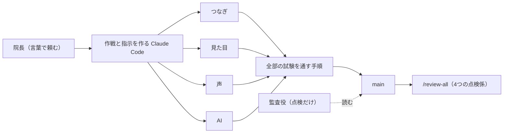

# チェアサイドビュー

最初に作った版は、試験が全部通っていました。ところが診療室の機械の前で自分の声で試すと、覆髄（ふくずい）が抜髄（ばつずい）に化けて画面に出ました。字は似ていても、歯の神経を残す処置と取る処置は逆の話です。直しては試し、また別の言い間違いを見つける。この作品は、その繰り返しでできています。

私は歯科医師で、プログラムは書けません。診療台のそばでの困りごとを言葉で伝え、Claude Code に作ってもらいました。

## 何をする道具か

診療中、歯を削っている最中に「この方、アレルギーはあったか」と思う。手袋は汚れている。端末に触るには外すか、誰かに頼むしかない。チェアサイドビューは、その場面のための画面です。手袋のまま、足元か手元の3つのボタンと声だけで、患者様の記録を大きく出します。

- **記録を見る**: 声で「重要事項を全画面にして」「3番を拡大して」と言うと、重要事項・全身既往・治療計画・過去の診療メモ・写真・歯の状態・歯周検査が全画面で出る。
- **質問する**: 「アレルギーは？」「前回は何をした？」のような質問に、記録の該当の箇所を、書いてあるとおりに大きく出す。
- **話した内容を下書きにする**: 診療中の会話を録音すると、文字に起こし、聞き違いを歯科の言葉に直し、5項目（やったこと・説明したこと・次回の予定・今後の治療計画・今後の治療方針）の下書きにする。**人が見て確定するまで、診療メモにも治療計画にも入らない。**
- **入口が2つ**: 最初の画面で「臨床モード」（ユニット用。声と3つのボタン）と「受付モード」（受付用。マウスだけ。次回の予約・来院しやすい曜日・受付メモなど患者様の前に出さない情報を含む）を選ぶ。

データは全部、架空です。本物の患者様の情報は入っていません。

## 触り方（審査の方へ）

Windows で作って確かめています。必要なものは次のとおりです。

- Python 3.10 以上（作者は 3.12）
- ffmpeg（録音を音声に戻すのに使う。PATH に通しておく）
- 画面の試験を動かすなら Microsoft Edge（Playwright から呼ぶ）
- 文字起こしは GPU（NVIDIA）があると速い。無いと CPU で動くが、遅くなる。

```
python -m venv .venv
.venv\Scripts\activate
python -m pip install -r requirements.txt
python scripts/seed.py
start.bat
```

- 部品の一覧は requirements.txt。架空のデータは `python scripts/seed.py` で作る（data/runtime に作られる。コミットしない）。
- 起動は `start.bat`。既定のポートは 8840 で、環境変数 CV_PORT で変える。スマホの写真の受け渡し用に、別のポート（既定 8841、環境変数 CV_MOBILE_PORT）の小さなサーバーも立ち上がる。`start.bat` は院内の他の端末からも開けるように、ネットワーク全体で待ち受ける。手元のパソコンから開くアドレスは `http://127.0.0.1:8840` 。
- 最初に開くのは入口の画面（`http://127.0.0.1:8840/`）。右の「臨床モード」を押すと今日の予約一覧（/clinic）。0123 の行を押すと歯科医師の画面が開く。左の「受付モード」は受付用の患者様一覧（/reception）。
- **マイクが無くても試せます。** 歯科医師の画面（`/unit?appt=…`）のアドレスの最後に `&typed=1` を足すと、右下に文字の入力欄が出る。声の代わりに「重要事項を全画面にして」「アレルギーは？」と打てば、同じ動きをする。
- 録音は、マイクがなくても `/recordings` を開き、「文字を貼り付けて下書きにする」の欄に話した内容の文字を貼ると、下書きまで試せる。
- ブラウザのマイクは、`http://127.0.0.1` か `http://localhost`、または https のアドレスでしか使えない（ブラウザの決まり）。
- ボタンは Ctrl+Shift+F6（ボタン1・録音）、F7（ボタン2・声の指示）、F8（ボタン3・画面を隠す）。どれも2回押し（1回目は帯が出るだけ。5秒以内にもう一度）。
- **Claude の鍵が無いと使えない機能**: 質問のうち「よく聞く質問」以外、聞き違いの清書、話した内容の下書き。鍵は環境変数 `CHAIRSIDE_CLAUDE_KEY` で渡す。無いときは、その機能だけ画面に「使えません」と出て、ほかは動く。鍵はリポジトリに入れない。
- **GPU や文字起こしのモデルが無いと使えない機能**: 声と録音の文字起こし。初めて使うとき、モデル（Whisper large-v3）を自動で取得する（数 GB。置き場は環境変数 CV_CACHE、無ければ作品のフォルダの隣の _cache）。取得しない状態でも、文字の入力（上の `&typed=1`）で、決まった言葉の操作は全部動く。
- 試験は `python -m pytest -m "not gpu"`（偽物の Claude の口と偽物のマイクで動く。画面の試験は Edge が要る）。GPU を使う試験は `-m gpu`。

## 過去のシステムとの関係

私の医院には、診療の情報を見る自作のシステムが以前からあります。患者様の情報を見ること、声で入力することは、この作品と似ています。ただし、この作品はそのコードもファイルも使っていません。画面も含めて、期間中に新しく作りました。

## AI の役割

診療のなかで、AI は「確認と記録を手伝う」だけです。院長の言葉で言うと、「AIはあくまでも確認と記録を手伝うだけで、アドバイスはしません」。

- 診断も治療の提案もしない。
- 声の質問は、登録された記録を選んで、書いてあるとおりに出すだけ。本文は Claude が書き直さず、データベースの文字をそのまま出す。
- 聞き違いの清書は、聞き取りの文の言葉だけを直す。話していないことは足さない。
- 話した内容の整理は下書き。歯科医師が確認して、確定するまで記録に入らない。
- 送る前に、患者様・職員の名前やカルテ番号などを伏字にし、残りがあれば送らない（app/ai/gateway.py が送信の唯一の口）。

## Claude の使い方

### 作品の中で Claude が担当すること

作品が動いているとき、Claude を呼ぶのは3か所だけです（表の下の3行）。上の2行は、Claude を使わずに表で動かします。

| 場面 | どうしているか |
|---|---|
| 決まった言葉（全画面、戻して、など） | 手元の言葉の表で照合する。Claude は使わない |
| よく聞く質問（前回・アレルギー・薬・次回） | 言葉の表（config/quick_answers.json）で記録から直接出す。Claude は使わない |
| それ以外の質問 | Claude Haiku が、記録の番号を選ぶ。本文はデータベースの文字をそのまま出す |
| 聞き違いの清書 | Claude Sonnet が、聞き取りの文を歯科の言葉に直した全文と、直した所の一覧を返す。話していないことは足さない |
| 話した内容の下書き | Claude Sonnet が5項目に分ける。話していないことは足さない（抜き出しの照合） |

「よく聞く質問は Claude を通さない」のは、診療中は待たされたくないからです。質問の待ち時間のほとんどが Claude の約1.9秒だったので、よく聞く4つは表から直接出すようにしました。

モデルは実測で選びました（docs/モデルの選び方.md）。架空のデータで声の質問30問を作り、Haiku・Sonnet・Opus に1回ずつ答えさせた結果は次のとおりです。

| モデル | 正解（30問） | 時間の中央値 |
|---|---|---|
| claude-haiku-5-5（採用） | 30 / 30 | 1.05秒 |
| claude-sonnet-5-5 | 29 / 30 | 1.48秒 |
| claude-opus-5-5 | 29 / 30 | 1.86秒 |

清書は、Sonnet と Opus を同じ文で3回ずつ試し、どちらも 45 / 45 で直し残し・余計な直しは0でした。正しさが同じなので、速い Sonnet（平均3.8秒、Opus は4.0秒）にしました（docs/清書のモデル比べ.md）。モデル名はプログラムに書かず、config/model.json から読みます。本物の Claude を呼んで確かめた結果は docs/実API結果.md に残しています。

### 開発の進め方

作者は歯科医師で、プログラムは書けません。言葉の指示だけで作りました。

Claude Code を開発の中心に置き、4つの作業場を同時に動かしました。「つなぎ」（データと画面の入口）、「見た目」、「声」、「AI」です。同じ時間に、別々の担当の Claude Code が、別々のファイルを直します。ぶつからないよう、担当ごとに直すファイルを決め、出来上がったものは、全部の試験を通してから main へ入れる決まりの手順（大会用の道具）を必ず通しました。11/2 から 11/6 までの5日間で、制作記録は100行を超え、全件の試験は956件です。

窓ごとのモデルは、記録を数えた範囲（11/6 19:44 まで）で次のとおりです。つなぎは Sonnet 5.5 が749回、声は Sonnet 5.5 が885回、AI は Sonnet 5.5 が1,040回。見た目は Opus 5.5 が374回と Sonnet 5.5 が121回。点検だけをする監査役の窓は Haiku 5.5 が97回です。コードを書く窓には Sonnet、見た目の仕上げには Opus、点検には Haiku、と目的で分けました。

作戦を立てて指示を作る Claude Code と、作品を作る Claude Code は、別にしました。作業場の会話を軽く保つためと、医院の本番の情報や既存のコードが作業場へ入らないようにするためです。



### 期間中に作った開発の道具

- `.claude/agents` の読むだけの点検係4つ: medical-wording（診断や提案に読める言い方を探す）、public-safety（公開してよいかを調べる）、judge-view（初めて見る人の目で読む）、test-gap（試験の無い所を挙げる）。
- スキル `/review-all`: 4つの係を同時に立て、結果を docs/総点検.md の表にまとめる。
- コミット前のフック（.claude/hooks/commit_guard.py）: 鍵・音声・位置情報つきの写真・data/runtime をコミットの前に止める。
- サブエージェントで分けた場面: 11/3 に /review-all を作って試したとき、4つを同時に立てた（最初の型の指定では結果が残らず、同じ4つを立て直した）。11/6 の提出前の点検（G27）でも、4つを同時に立てた。公開の点検では、見本の名前や写真の出どころなど、院長が決めることの洗い出しが見つかった。くわしくは docs/総点検.md。

### 開始前から使っている仕組み

次のものは、期間の前から使っている仕組みで、評価の対象ではありません。

- 連続実行の `/longrun`（長い仕事を、終わりの条件を決めて続ける仕組み）
- 監査役の窓（点検だけをする Claude Code）
- 進行管理の Claude Code

## 素材の出どころ

審査の対象は、Claude Code で作ったプログラムです。プログラム以外の素材は、次のとおりです。

- 写真（data/photos）の19枚（写真17枚と診察券の裏面2枚）は、すべて院長が用意した見本の画像で、実在の患者様の写真ではない。全部に右下に「見本」の札が入っている。
- 6〜9番（治療の工程：治療前・インレーを外した・むし歯を取った・治療後）は、Claude が ComfyUI（モデル z_image_turbo）で作った写真。院長の画像は構図の手本として見ただけで、生成には入れていない。4枚とも同じ構図で、治療している1本だけが変わる。8番だけは、7番の穴の中の色をプログラムでクリーム色に塗り替えた下絵を ComfyUI で仕上げた。
- 写真の作り方の記録と生成の道具は、リポジトリの外にある。
- 書体は Noto Sans JP（SIL Open Font License 1.1）。
- docs/画面 の画像は、この作品の画面を撮ったもの。
- 音声の録音・送信の記録・データベースは、リポジトリに入れない（data/runtime は .gitignore）。

## 使った部品とライセンス

作者の環境で動いている版です（requirements.txt、くわしくは docs/使った部品.md）。

| 名前 | 版 | ライセンス | 使い道 |
|---|---|---|---|
| fastapi | 0.162.0 | MIT | サーバー |
| uvicorn | 0.54.0 | BSD-3-Clause | サーバーの起動 |
| python-multipart | 0.0.33 | Apache-2.0 | 画面から送られた写真・録音を受け取る |
| anthropic | 2.3.0 | Apache-2.0 | Claude の呼び出し |
| faster-whisper | 1.2.1 | MIT | 音声の文字起こし |
| Whisper large-v3（モデル。Systran/faster-whisper-large-v3、元は OpenAI Whisper large-v3） | large-v3 | MIT | 音声認識のモデル |
| numpy | 2.5.4 | BSD-3-Clause | 音声の配列 |
| Pillow | 13.0.0 | MIT-CMU | 写真の向き直し・位置情報の削除 |
| segno | 1.6.6 | BSD | スマホ用の QR |
| ffmpeg（外部の道具） | 8.1.1 | GPL（full build） | 録音を音声に戻す。リポジトリには含めない |
| Noto Sans JP（書体） | 2.004 | SIL OFL 1.1 | 画面の書体（3つの太さ、字を絞った woff2） |
| pytest | 9.2.0 | MIT | 試験 |
| playwright | 1.64.1 | Apache-2.0 | 画面の試験（インストール済みの Edge を使う） |
| httpx | 0.28.1 | BSD-3-Clause | 試験でサーバーへ接続する |
| fonttools | 4.68.0 | MIT | 書体を絞る開発の道具（作品には含めない） |
| brotli | 1.2.1 | MIT | woff2 の圧縮（開発の道具） |

## 試験と確かめたこと

- 普段の試験は偽物の Claude の口で動かす（`python -m pytest -m "not gpu"`、956件）。本物の Claude で確かめた結果は docs/実API結果.md。
- 声は、実機のマイクで院長が何度も通しています（制作記録の G14c・G14e・G19b・G19i・G14p・G14q）。その中で、音楽が流れるユニットで5番と8番が聞き取れない、覆髄が抜髄に化ける、AI デスクでマイクの音が入らず「ご視聴ありがとうございました」と出る、といった失敗が見つかり、直しました。自動の試験で偽物のマイクを使うのは、実機のマイクを毎回は使えないためです。
- 実機のマイクの通しを、全員の環境で確かめたわけではありません。マイクの種類や部屋の音で、聞き取りは変わります。

## 今の限り、そして今後の案

作っていないものは次のとおりです。診断や治療の提案、本物の患者様のデータ、カメラ、レントゲンの解析、本物のカルテとの連携。

今後の案は2つです。どちらもまだ作っていません。

1. 声で入れた歯の状態・次の予約・治療歴を、後からキーボードでも入力・修正できるようにする。
2. 医院ごとに合わせて育て、自院では今のカルテの仕組みとつないで使い続ける。

## 動画の撮影のための道具

scripts/insert_recording.py は、動画の撮影のために録音を入れる道具です。

## ライセンス

MIT License（LICENSE）。著作者は大川内。

## 文書

docs/仕様.md、docs/通しの手順.md、docs/使った部品.md、docs/実API結果.md、docs/制作記録.md、docs/総点検.md、docs/点検結果.md
