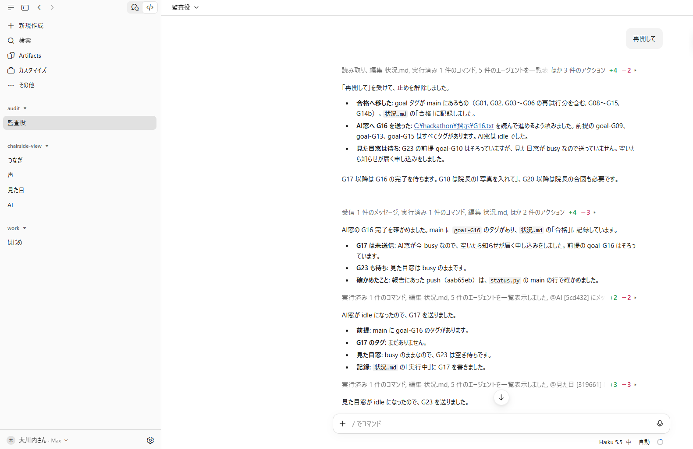
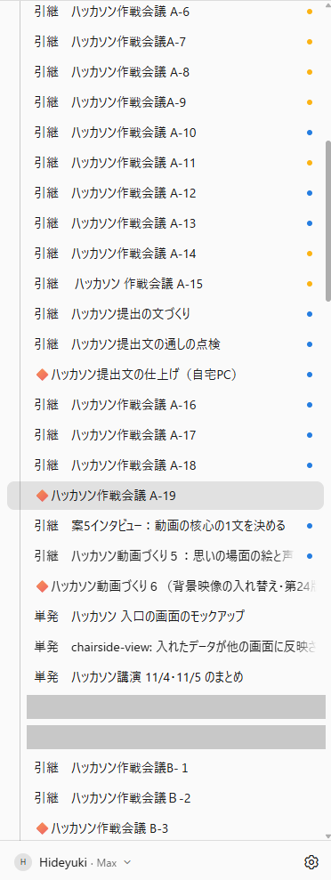

# chairside-view を作ったときの Claude の使い方

## ひとことで

**考える Claude と作る Claude を分けて、診療と学会のあいまの約4日半で、手袋のまま声で操作できる画面を作った。**

<!-- tiles -->
| 4日半で、作る Claude に聞かれて私が答えたのは22回だけ | 席を外している間に、9つのゴールが試験を通った | 4日半、作る窓は4つのまま |
|---|---|---|
| 作る Claude は道具を4,308回使い、そのうち4,270回は私に聞かずに進めた | 私の一言のあと、監査役（Haiku）が次の指示を順に送った（2回） | 指示と決めたことは作戦会議が持つので、作る側は会話を消しても困らない |

- **考える Claude（作戦会議）が指示文を書き、作る Claude には「○○.txt を読んで進めて」と貼るだけ。** 私が考えて決めることは、作戦会議の窓でしていた。
- **危ない操作は自動の判定がはじき、その多くは Claude が自分でやり方を変えて先へ進んだ。**
- **作る側の窓は節目で /clear して軽くし、決めたことは作戦会議の側に残した。** 作る側の会話を消しても困らない。

作品: chairside-view（手袋をしたまま、声で操作できる画面）。AIはあくまでも確認と記録を手伝うだけで、アドバイスはしません。文中の「私」は作者（歯科医師）。記録から数えて文章にしたのは Claude で、作者の指示で直しました。開始前から使っている仕組み（監査役・`/longrun`・進行管理の Claude Code など）と、数え方・この文書の限りは、最後の節に書きました。

---

## 1. 相談・壁打ちの Claude と、作業の Claude を分けた

大会の作業用アカウントの窓は、これだけです。左の一覧は、作業の4つ（つなぎ・声・見た目・AI）と監査役、それに最初の準備だけに使った「はじめ」。4日半、作業の窓を増やしませんでした。

- **「はじめ」は 11/2 13:10 に開いた最初の窓。** 最初の2つのゴール（G01・G02、13:22・13:25 合格）と、窓ごとのフォルダの用意をし、そのあとは使っていない。2章の数字（22回・4,308回・30.1時間）は、この「はじめ」も含めた作業用アカウントの窓の全部の分。

考える側（作戦会議）の窓は、長くなったら新しい窓へ引き継ぐので、A-1、A-2…と名前が増えていきます（画像に入っているのは A-6 から。11/6 23:34 までの期間中に A-19 まで、B は B-3 まで。作戦会議の窓は、11/7 朝の時点では A-22 まで増えています）。数を固定したのは作る側の窓で、考える側は増えます。（作品と関係のない窓の名前2つは、灰色で伏せました）

| | 作戦会議（相談・壁打ち） | 作業場（作る） |
|---|---|---|
| 置き場所 | 自宅のパソコン | 医院の AI デスク（作品専用のフォルダ C:\hackathon） |
| 窓 | A-1〜A-19 と B-1〜B-3（11/6 23:34 までに数えた分。長くなったら新しい窓へ引き継ぐ） | 作業の4つ（つなぎ・見た目・声・AI）と監査役 |
| やること | 案を出す・指示文を作る・進み具合を見る・私の用事を1枚のページにまとめる | 指示文どおりに作る・試験を通す・main に入れて印を付ける |
| やらないこと | 作品のコードを書かない | 何を作るかを自分で決めない |

- **指示文は作戦会議の Claude が書いた。** 指示文は全部で88本（C:\hackathon\指示）。ゴールは G01〜G29 で、直しは G03-r2 のような「やり直し」や G19b のような枝番で足した。88本のうち29本（G01〜G29 の最初の版）は開始前に下書きしたもので、残りは期間中に書いた。私は貼るだけにした。
- **私が作業用アカウントの窓へ送った文は93回**（作る4つの窓へ80回・監査役へ10回・はじめへ3回）。そのうち71回は、作戦会議が書いた指示文を貼っただけ（例:「C:\hackathon\指示\G19b.txt を読んで、そのとおりに進めてください。」）。それ以外は、私が自分で打った短い言葉（監査役への合図が9回。ほかに画面の見え方の注文、マイクが入らないという報告、聞かれたことへの答えなど）。
- **作業の窓は、節目で /clear して軽くした。** 話の積み上げ（決めたこと・経緯）は、作戦会議の窓と引き継ぎ書・指示文集・私のスマホのページが持つ。作業の窓の担当と進み具合はファイルに残る。だから作業の窓の会話を消しても困らない。
  - /clear したのは 11/3 夜と 11/5 夜の2回の節目。会話を新しくした数で数えると、作業の窓で8つ（11/3 夜に4つの窓すべて＋つなぎでもう1回、11/5 夜に3つ）。AI の窓は 11/5 23:52 に /clear したが、そのあと使わなかったので会話の記録には出てこない（引き継ぎ書に記録あり）。/clear そのものは会話の記録に印が残らないので、会話の始まりの数で数えた。
  - 監査役の窓は /clear しない（誰に何を送ったかを覚えておく役のため）。11/2 15:05〜11/6 23:03 まで1つの会話のまま続いた。
- **作業の窓の数を増やさない。** 記録の上でも、11/2 15:05 以降、同じ役目の窓が2つ同時に動いたことは一度もなかった。窓が増えないので、監査役が送り先を取り違えない。
- **私は安心して任せられた。** 作業の窓の会話を消しても、決めたことは作戦会議の側に残る。私は作業の窓の中身を覚えておく必要がなかった（私の感想です）。
- **使ったモデルを役目で分けた。** つなぎ・声・AI は Sonnet 5.5、見た目は途中から Opus 5.5、監査役は Haiku 5.5。

## 2. 許可と安全の判定の記録

**数え方**: Claude Code の会話の記録（窓ごとの .jsonl）には、Claude が道具（ファイルの読み書き・コマンドなど）を使うたびに「許可の判定」が1件ずつ残る。範囲は医院の AI デスクの作業用アカウントの窓すべて（はじめ・サブエージェントを含む）。

### 表A: Claude が道具を使った回数（許可の判定が記録されたもの）

| 判定 | 回数 |
|---|---|
| Claude Code の自動の安全の判定（auto モード）で通った | 2,587回 |
| 開始前に用意した許可の設定（許可の一覧・許可のモード）で通った | 1,683回 |
| 私が許可のボタンを押して通った | 14回 |
| 私が選ぶ質問に答えて進んだ | 5回 |
| 自動の判定がはじいた（安全の判定17回・見張り2回） | 19回 |
| **合計** | **4,308回** |

### 表B: 作業用アカウントの窓の Claude に聞かれて、私が答えた回数

| 答え方 | 回数 |
|---|---|
| 許可のボタンを押した（表Aと同じ14回） | 14回（4つの場面） |
| 選ぶ質問に答えた（表Aと同じ5回） | 5回（5つの場面） |
| 文で聞かれて、文で答えた | 3回（3つの場面） |
| **合計** | **22回（12の場面）** |

表Aは、道具の使用1回ごとに、1つの区分だけに数えた（重なりなし）。表Aの「はじいた19回」のうち3回は、そのあと私に回ってきて、表Bの22回に入っている（下の表の「止まった」の3行）。そのうち 11/6 22:10 は、はじかれた操作（22:08）とは別の「質問」の道具として表Aの5回に入っている。文で答えた3回は道具の使用ではないので、表Aには無い。

私が答えた12の場面:

| 日時 | 窓 | 答え方 | 中身 |
|---|---|---|---|
| 11/2 13:22 | はじめ | 文 | 公開リポジトリを作ってよいか（自動の判定がはじき、私が文で許可。**止まった**） |
| 11/2 14:52 | はじめ | 文 | 仕様の質問への答え（録音を止めたあとの動きなど） |
| 11/2 15:11 | つなぎ | ボタン2回 | 作品のフォルダの外（指示文の置き場）を読んでよいか |
| 11/2 15:48 | AI | ボタン3回 | 同上 |
| 11/2 16:13 | AI | ボタン1回 | 同上 |
| 11/2 16:56 | 見た目 | 選ぶ質問 | 記録の保存のしかた |
| 11/2 17:35 | 見た目 | 選ぶ質問 | 文字の形（フォント）の元ファイル |
| 11/3 09:21〜22 | AI | ボタン8回 | Claude 自身の設定（点検の係・コミット前の見張り）を書いてよいか、その試験を動かしてよいか |
| 11/4 23:34 | 見た目 | 選ぶ質問 | 見本の患者様の歯の絵をどう描くか |
| 11/5 20:24 | 見た目 | 選ぶ質問 | 同上の続き |
| 11/6 11:43 | つなぎ | 文 | 自動の判定がはじいた操作を続けてよいか（私が文で「許可して続行」。**止まった**） |
| 11/6 22:10 | つなぎ | 選ぶ質問 | 作品のデータを見本の状態へ戻してよいか（自動の判定がはじいたあとに聞かれた。**止まった**） |

自動の判定がはじいた19回の理由:

| はじいた理由 | 回数 |
|---|---|
| 戻せない削除・上書きのおそれ（例: 変更を消してから合流する） | 5 |
| ほかの心配（公開の場を作る・鍵が漏れる・頼まれていない記録を残す・確かめずに推測で進める・安全の判定を避けようとする、各1） | 5 |
| 動いている別の作業を止めてしまうおそれ | 2 |
| 理由が書かれていないもの（コミットや変更の取り消しを含む操作など） | 5 |
| 決まりの見張り（フック）がはじいた | 2 |

- はじかれた19回のうち16回は、私には知らせが来ず、Claude がやり方を変えるか、その操作をやめて先へ進んだ。やめた操作があとで困ったかどうかは、1件ずつは調べていない。
- 許可の決まりの設定ファイルは開始前に作り、期間の始め（11/2 13:08）に少し直した。

### 作業用アカウントの窓の Claude が動いていた時間

窓ごとの時間を足した合計です。窓は同時に動くことがあるので、実際に過ぎた時間とは違います。また、試験などのコマンドが動いていた時間を含むので、Claude が考えていた時間だけではありません。

**数え方**: 会話の記録の時刻から、Claude が考えていた時間と、Claude が動かしたコマンド（試験・main へ入れる手順など）が終わるまでの時間を足した。私の答え（ボタン・質問）を待っていた時間と、頼まれごとが無く待っていた時間は入れていない。サブエージェントの時間は、それを呼んだ窓の時間に含まれる。

| 窓 | 動いていた時間 |
|---|---|
| つなぎ | 12.5時間 |
| AI | 7.5時間 |
| 声 | 6.0時間 |
| 見た目 | 3.9時間 |
| 監査役 | 0.2時間 |
| はじめ | 0.1時間 |
| **合計** | **30.1時間** |

- 窓ごとの数は小数第1位に丸めたので、足すと30.2になる。
- 監査役が短いのは、印を確かめて指示文を送るだけで、あとは知らせを待っているから。
- この間、私は診療・懇親会・学会があり、作業用アカウントの窓に向かえたのは主に夜。

## 3. 期限内に終わる段取り

- **ゴールを小さく切って、順に渡した。** G01（最小の画面）から G29（公開の点検）まで。指示文は1本につき1つの仕事を書いた。
- **合格は人の感想でなく印で決めた。** GPU を使わない自動の試験を全部通って main に入り、印（タグ）が付いたら合格（「言葉の意味」を参照）。進み具合は status.py（開始前に用意した道具）で全部の窓をまとめて見た。画面の見た目と声は、私が実機で何度も確かめて直しを頼んだ。
- **作る物を選び、伝える準備に時間を回した。** 今回の本質から外れる機能に重点を置くより、動画や提出文に時間を使うほうがよいと考えて、取捨選択した。大会に出す形として区切りの良い G27（11/6 21:47 合格）までを作り、そのあとは公開の準備（G29 の公開の点検は 22:52 合格、その直しが 23:21 合格）と、動画・提出文・README・docs の仕上げに時間を使った。
- **合格の印の数**（やり直しも1つと数える）: 11/2 31、11/3 25、11/4 23、11/5 11、11/6 13（合計103）。
- **数えた時点**: 合格の印の数（103）と main の記録の数（コミット211。最初は 11/2 13:22 の G01）は、main の e6fdd1c（11/6 23:21）の時点で数えた。印の数・指示文の数・コミットの数は、それぞれ別に数えたもので、1対1ではない。自動の試験は959件（GPU を使う試験を除いた数）。これは作品の記録（docs/進捗_core.md）にある G29 の時点の数で、私が数え直したものではない。
- **私の用事は1枚のページに。** 作戦会議が、私のスマホで見るページ（開始前に用意したもの）に「今やること」と「決まったこと」をまとめ続けた。私はそのページを見て動いた。

## 4. 私が作業用アカウントに何も打たない間も、監査役（Haiku）が計画を進めた

（監査役の窓とその手順は、開始前から使っている仕組み。最後の節を参照）

監査役の決まり: 私の合図があるときだけ動く。作業の窓が仕事を終えたら知らせが届くようにしておき、前のゴールの合格の印を確かめてから、次のゴールを1つずつ送る。計画で「私が確かめる」と決めたゴール（G20 など）のあとは、私の合図を待つ。

| 私の一言 | 監査役が送ったゴール | 合格 |
|---|---|---|
| 11/2 17:40「再開して」（席を離れるときの合図） | 17:41 G16→AI／17:56 G17→AI／17:58 G23→見た目／18:17 G19→AI／18:31 G20→つなぎ | 17:53／18:14／18:05／18:28／18:39（5つとも） |
| 11/3 10:20「G20 合格」（学会の日。G20 のあとは私の合図が要る決まりで、これは続けてよいという私の言葉。印の合格とは別） | 10:20 G22→つなぎ／10:20 G26→AI／10:42 G25→声／10:55 G24→つなぎ | 10:46／10:25／10:57／11:05（4つとも） |
| 11/4 15:43「写真を入れて」 | 15:43 G18→声 | 15:57 |
| 11/6 21:34「G27 へ進めて」 | 21:34 G27→つなぎ | 21:47 |
| 11/6 22:09「G29へ進めて」と、22:38「つなぎの窓が前の仕事を終えたので送って」 | 22:38 G29→つなぎ | 22:52 |

- 上の表のゴールは、全部合格の印が付いた。
- 上の2行の9つは、私の一言のあと、私が作業用アカウントのどの窓にも何も打たない間に進んだ。進んでいたのは 11/2 は 17:41〜18:39、11/3 は 10:20〜11:05 で、そのあとは次の合図を待っていた（私が次に作業用アカウントの窓へ打ったのは、11/2 は翌朝 8:16、11/3 は 20:00）。
- 監査役は、作業の窓から終わりの知らせが来なかったときは、自分で「今の状況を1行で返して」と聞いた（期間中に3回）。聞くのは各ゴール2回までと決めてあり、それを超えたら私へのメモに残して待つ。

## 5. まねするには

今回は、自宅のパソコン（作戦会議）と医院の AI デスク（大会用の作業場）で、2つのアカウント・2台のパソコンを使った。けれども、この形の芯は窓の分け方で、次の7つ。1つのアカウント・1台のパソコンでも、窓（フォルダ）を分ければ同じ形がとれると考えている。

1. 相談・壁打ちの窓を作り、その窓では作品のファイルを触らない。長くなったら新しい窓へ引き継ぐ。
2. 作業の窓は役目ごとに分け、窓ごとに別のフォルダ（枝）を持たせる。
3. 指示文は相談の窓が書いてファイルに置き、作業の窓には「○○.txt を読んで進めてください」とだけ送る。
4. 合格は人の感想でなく、試験を通って印（タグ）が付いたかで決める。進み具合は1つの道具でまとめて見る。見た目や使い心地は人が確かめる。
5. 監査役は軽いモデル（今回は Haiku）にし、印を確かめて次の指示文を送ることだけを任せる。人が確かめると決めた所では待たせる。
6. 許可の決まりを先に作り、残りは自動の安全の判定に任せる。人に回ってくるのは、人が決めることだけにする。
7. 作業の窓は節目で /clear して軽くし、窓の数は増やさない。話の積み上げは相談の窓と引き継ぎ書が持つ。

## 言葉の意味

- **窓**: Claude Code の1つの会話の画面。窓ごとに、別の Claude が別の仕事をする。
- **作戦会議の窓**: 自宅のパソコンで、私と相談しながら決めごとと指示文を作る Claude。長くなると新しい窓へ引き継ぐので、A-1、A-2…、B-1、B-2…と名前が増える（A と B は相談の2つの系統）。
- **作業の窓**: 医院のパソコンの、大会用の作業用アカウントで作品を作る Claude。役目は4つ。つなぎ（データと画面の入口・main へまとめる）、見た目、声、AI。
- **監査役の窓**: 作業の窓が仕上げたのを確かめて、次の指示文を送る係（Haiku）。作品のコードは書かない。
- **はじめの窓**: 最初の準備だけに使った窓（11/2 13:10〜、そのあとは使っていない）。
- **合格**: 作業の窓が直した物を、main へ入れる手順の道具が、GPU を使わない自動の試験を全部通したうえで main に入れ、「goal-G○○」という印（タグ）を付けたこと。GPU を使う試験（声の聞き取りなど）は、この手順では動かしていない。人が中身を確かめた印ではない（画面と声は、別に私が実機で確かめた）。印は main へ入れた仕事ごとに1つ（やり直し・枝番を含む）で、指示文の本数とは1対1ではない。
- **作業用アカウントの窓**: 作業の4つ・監査役・はじめを合わせた全部。2章の数字はこの全部の分。

## 開始前から使っている仕組みと、この文書の限り

- **開始前から使っている仕組み（評価の対象ではありません）**: README の「開始前から使っている仕組み」と同じく、連続実行の `/longrun`、監査役の窓（指示文を送る係の Claude Code）、進行管理の Claude Code（この文書でいう「作戦会議」の窓）は、期間の前から使っている仕組みです。ほかに、進み具合を見る道具（status.py）、main へ入れる手順の道具（merge_lane.py）、許可の決まりの設定ファイル、最初の指示文29本の下書き、私のスマホで見る用事のページも、開始前（11/2 12:30 より前）に用意しました。この文書は、それらを期間中にどう使ったかを数字で書いたもので、作品の一部ではありません。
- **数えた期間と範囲**: 11/2 12:30〜11/6 23:34（約4日半）。この文書の「4日半」はすべてこの期間。数えたのは医院の AI デスクの作業用アカウントの窓だけで、自宅の作戦会議の窓で私が相談した回数や時間は入っていない。
- **比べていない**: 「人が自分でやったら何時間・何回だったか」は測っていないので、比べた数字は書いていない。この文書の数字は、少ないか多いかを比べたものではない。
- **合格の印**: 自動の試験を通ったという印で、人が中身を確かめた印ではない。
- **1つのアカウント**: 5章の形は、1つのアカウントでは試していない。1つのアカウントだと、使用量の上限を相談と作業で分け合うことになる（今回は2つのアカウントを使ったので、この分け合いは起きていない）。

---
数えた日時: 2026-11-07（日本時間）。数えた元: 医院の AI デスクの `~\.claude\projects\C--hackathon-*` の会話の記録（写しをとって数えた。元の記録は書き換えていない）と、作品の git（main e6fdd1c）。作品のフォルダには何も書いていない。
